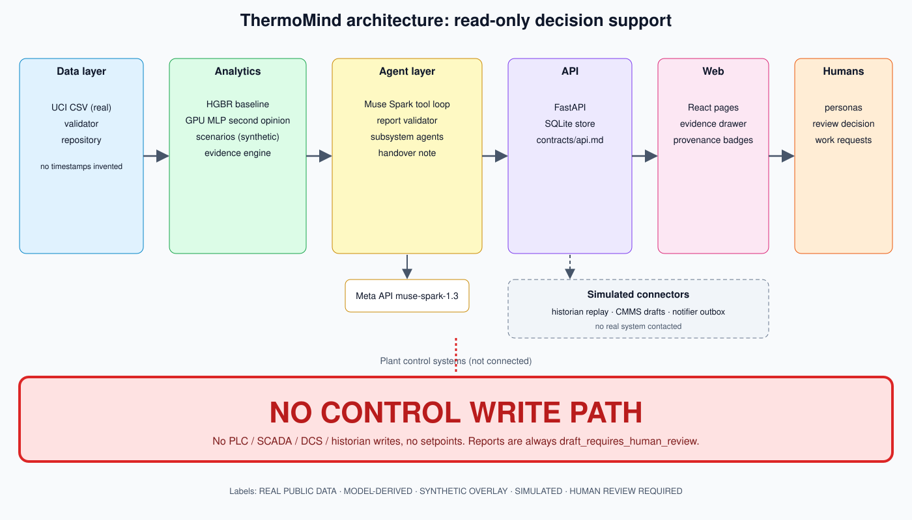
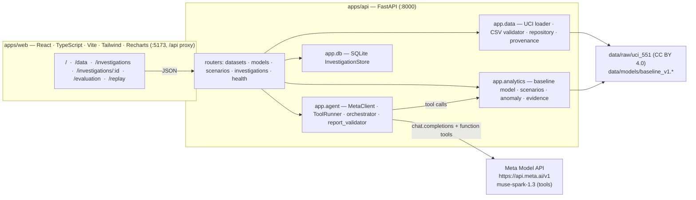
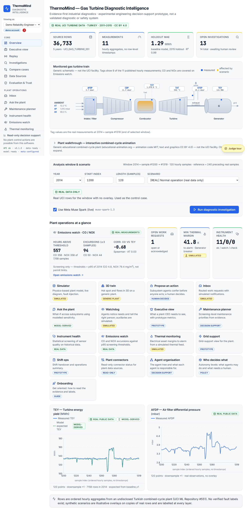

# ThermoMind

**A read-only AI diagnostic investigator for gas-turbine power generation.**

ThermoMind combines authentic operating measurements, reproducible anomaly analysis, Meta Muse Spark reasoning with real tool use, and inspectable evidence to help plant engineers prioritize investigations.

> **Status (honest banner):** hackathon prototype built during the Meta Global AI Developer Hackathon (Startup Track). The repository's git history begins 2026-11-04 18:15 UTC; the project was restarted from an empty directory that day after earlier work became inaccessible. All code in this repository was written during the hackathon window. It is decision-support software for exploring a public data set. It is **not** a validated plant safety, monitoring or control system; it has **no** write path to any PLC, SCADA, DCS or historian; every report is `draft_requires_human_review`. No accuracy, uptime, adoption or commercial claims are made. All numbers shown in the app come from running the code in this repository (see [docs/EVALUATION.md](docs/EVALUATION.md)).

---

## The problem

A combined-cycle or simple-cycle gas turbine streams dozens of measurements every hour. When output drifts, the performance engineer's job is to decide, quickly and defensibly, *whether this is worth an investigation*, and if so *which hypothesis to chase first*: a fouling intake filter, an ambient shift, a drifting sensor, a dispatch change. Today that triage is manual spreadsheet work on top of vendor alarms that rarely explain themselves.

ThermoMind turns one window of plant data into an **investigation case**: evidence items with the exact computation behind each number, a baseline-model comparison with explicit uncertainty, ranked hypotheses that cite only evidence that exists, and a full trace of what the AI model asked for and received. The engineer reviews and accepts, rejects or asks for more data. The system never acts.

## What it does

1. **Loads real measurements** from the UCI Gas Turbine CO and NOx Emission Data Set (36,733 hourly aggregates, 2011–2015) or a user-uploaded CSV with the same columns.
2. **Trains a reproducible baseline** (`HistGradientBoostingRegressor`, TEY from eight operating/ambient inputs, chronological split 2011–2013 / 2014 / 2015, compared against two naive baselines).
3. **Builds deterministic evidence** for a 120-row window versus the 240 preceding real rows: window-vs-reference statistics, trend slopes, residuals against the baseline, out-of-training-range counts, isolated-sensor flags, data-quality report.
4. **Runs a Meta Muse Spark investigation.** `muse-spark-1.3` receives the case and must call tools (`get_sensor_window`, `get_baseline_comparison`, `evaluate_hypothesis`, `get_data_quality`, `list_evidence`, `lookup_reference`) to obtain evidence IDs. It may only cite IDs that tools returned.
5. **Validates the report.** Unknown evidence IDs, case-ID mismatch, schema errors, fabricated dates or control instructions reject the draft; one bounded rewrite is allowed; otherwise the case is marked `needs_review` with a deterministic summary. Without an API key the app runs an **offline preview**, labelled "not a Meta inference" everywhere it is shown.
6. **Keeps a human in the loop.** Severity is a review-priority category, not an alarm. The engineer records a review decision; the full case exports as JSON.

## Architecture





Full data flow, component table and the sequence of one investigation: [docs/ARCHITECTURE.md](docs/ARCHITECTURE.md). The HTTP contract: [contracts/api.md](contracts/api.md); an illustrative `Investigation` payload: [contracts/examples/investigation.json](contracts/examples/investigation.json).

## Results (measured)

All values below were produced by running this repository's code; source: [docs/EVALUATION.md](docs/EVALUATION.md) (`data/models/baseline_v1.json`, `docs/EVALUATION_RESULTS.json`).

- **TEY baseline, 2015 holdout (n = 7384, never used for fitting):** MAE 1.293 MWh, RMSE 1.646, R² 0.9896. Naive train-mean MAE 12.957; naive previous-observation MAE 4.125. Chronological split: train 2011-2013, validation 2014, holdout 2015. This shows the features carry information about TEY; it is not a fault-detection accuracy (no fault labels exist).
- **Control windows:** 0 of 4 real-only windows (three 2015 windows plus S01) raised a notable residual flag. The three synthetic scenarios S02-S04 each ranked the expected deterministic hypothesis (S04 claims no fault). Not a false-alarm study.
- **Live Meta record (2026-11-04, `muse-spark-1.3` via `https://api.meta.ai/v1`):** three real investigations through the full pipeline: `case_76d34565b3dc` (S02, 10 tool calls, 4 model turns), `case_760658afb3d5` (S03, 9 tool calls, 3 turns), `case_b1d8db08ff82` (S01, 11 tool calls, 4 turns). All three accepted by the validator on the first pass, i.e. zero validation errors and no rewrites. Diagnostic correctness of the reports is not benchmarked.
- **GPU challenger (benchmark only):** PyTorch MLP `mlp_v1` (V100): validation MAE 1.113 vs HGBR 1.364; 2015 holdout MAE 1.664 vs HGBR 1.293 (RMSE 2.183 vs 1.646, R² 0.9818 vs 0.9896). HGBR retained as production.
- **Tests:** 140 passed (`cd apps/api && python -m pytest -q`).

## Screenshots

Demo video: link added at submission time (recording lives in `submission/video/`).

| View | File |
|---|---|
| Home / run an investigation | `docs/screenshots/home.png` |
| Data provenance (`/data`) | `docs/screenshots/data.png` |
| Investigation case with evidence and tool trace (`/investigations/:id`) | `docs/screenshots/investigation.png` |
| Baseline model evaluation (`/evaluation`) | `docs/screenshots/evaluation.png` |
| Agent replay (`/replay`) | `docs/screenshots/replay.png` |




## Data source and attribution

- **UCI Gas Turbine CO and NOx Emission Data Set**, ID 551, DOI [10.24432/C5WC95](https://doi.org/10.24432/C5WC95), licence **CC BY 4.0**. Kaya, H., Tüfekci, P. & Gürgen, F. (2019). UCI Machine Learning Repository.
- 36,733 one-hour aggregated rows, 2011–2015 (7411 / 7628 / 7152 / 7158 / 7384 rows per year), from an undisclosed gas-turbine plant in Turkey.
- Columns: AT °C, AP mbar, AH %, AFDP mbar, GTEP mbar, TIT °C, TAT °C, TEY MWh, CDP mbar (as published; unit and physical interpretation under validation), CO mg/m³, NOX mg/m³.
- **No row-level timestamps.** We keep `source_year` + `row_index` and never fabricate dates; the UI shows `2014 • sample #1253`. **No verified fault labels** exist. TEY stays in MWh as published.
- `data/fixtures/gt_2014_sample300.csv` (first 300 real rows of 2014) is redistributed under CC BY 4.0 for tests and offline demos.

Details: [docs/DATA_PROVENANCE.md](docs/DATA_PROVENANCE.md).

## Quickstart

Requirements: Python 3.12, Node 20, `make`. Internet access is needed once to download the UCI zip, and for live Meta inference.

```bash
git clone <repo-url> thermomind && cd thermomind
cp .env.example .env            # set MODEL_API_KEY=<your Meta Model API key>  (MUSE_API_KEY is an alias)
make setup                      # python venv + pip install + npm install
make data                       # downloads UCI 551 into data/raw/uci_551 (verifies headers + row counts)
make train                      # trains data/models/baseline_v1.* and prints real metrics
make dev                        # API http://localhost:8000, web http://localhost:5173
```

Other targets: `make seed` (demo cases), `make test` (pytest on fixtures + web typecheck), `make smoke` (HTTP smoke test), `make meta-smoke` (one live Muse Spark call, records model id / latency / tool calls), `make gpu-train` (optional PyTorch challenger on GPU), `make build` (web build + Docker image when Docker is available).

**Docker**

```bash
cp .env.example .env && $EDITOR .env
docker compose build
docker compose run --rm thermomind python /app/scripts/fetch_uci.py
docker compose run --rm thermomind python /app/scripts/train.py
docker compose up                # http://localhost:8000 (API + built web UI from one image)
```

The image is a two-stage build (`node:20-alpine` builds `apps/web`, `python:3.12-slim` serves the API and `apps/web/dist`). `data/` is a volume; the key is passed by environment only. The Docker path is written but was not exercised on the build machine (Docker not installed there).

## Meta integration

- Model: `muse-spark-1.3` via `https://api.meta.ai/v1`, OpenAI-compatible `chat/completions` with function tools and `tool_choice="auto"`. Muse Spark is a reasoning model: reasoning tokens count against `max_tokens`, so the client uses a large budget (`META_MAX_TOKENS`, default 6000) rather than a tight one.
- Key: `MODEL_API_KEY` (alias `MUSE_API_KEY`) read from `.env` server-side only. It is never logged, never included in error messages, never returned by any endpoint.
- The model does substantive work: it must call tools to see the window, the baseline comparison, hypothesis evaluations and data quality, and its report must cite the evidence IDs those tools returned. The stored event trace (`model_request`, `tool_call`, `tool_result`, `validation`, `rewrite_requested`, `report_accepted`) is shown in the UI and replayable at `/replay`.
- The validator is the gate between the model and the engineer: schema check, case-ID match, evidence-ID whitelist, no fabricated dates, no control instructions. One bounded rewrite; otherwise `needs_review`.
- `Investigation.meta_used` is `true` only when a real Meta API call produced the report. The offline preview (`mode="offline_preview"`) is built from the same deterministic tools and is labelled "not a Meta inference".

## Synthetic scenario disclosure

The data set contains no labelled faults, so three of the four demo scenarios apply a **seeded synthetic overlay to a copy of real rows**. Originals are never mutated, and `synthetic=true` plus `scenario_label="synthetic_overlay"` propagate through every response, evidence item and UI badge.

| Scenario | Overlay | Purpose |
|---|---|---|
| `S01_NORMAL` | none (real rows only) | control case: the pipeline must not invent faults |
| `S02_INTAKE_RESTRICTION` | AFDP ramps up; TEY ramps down by up to 3.5 %; slight CDP decrease | coherent multi-sensor pattern consistent with intake filter restriction |
| `S03_SENSOR_INCONSISTENCY` | isolated CDP offset, no corroborating sensors | an instrumentation-style inconsistency |
| `S04_AMBIENT_SHIFT` | AT / AH shift, output unchanged | operating-condition change, not a fault |

Default window: year 2014, rows [1200, 1320); reference: the 240 real rows immediately before. Seed 42. The scenarios' `expected_behavior` text is documentation only and is never passed to the model.

## Safety and scope

Read-only decision support. Zero write endpoints toward control systems; no PLC/SCADA/DCS/historian writes, no setpoints, no recommendations phrased as control actions (the validator rejects drafts matching a set of control-instruction patterns; this is a guard, not a guarantee). Reports are drafts that require human review; `severity` ranks review priority and is not an alarm. Threat model, mitigations and the planned OT-security assessment: [docs/SAFETY.md](docs/SAFETY.md).

## Tests

```bash
make test                      # cd apps/api && python -m pytest -q ; cd apps/web && npm run typecheck
make smoke                     # HTTP smoke test against a running API
make meta-smoke                # one live Muse Spark round-trip (needs MODEL_API_KEY); result recorded in docs/EVALUATION.md
```

API tests run on `data/fixtures` only (no network, no key). CI: [.github/workflows/ci.yml](.github/workflows/ci.yml).

## Known limits

- One plant, one undisclosed turbine type, 2011–2015, Turkey. Nothing here is validated on another machine.
- No timestamps, no fault labels, no load/dispatch signal: baseline residuals are confounded by dispatch changes and can only indicate deviation from a learned relation, not a diagnosed fault.
- Synthetic overlays are illustrations of physical tendencies, not recorded events.
- CDP is labelled "mbar" by the source; its magnitude suggests another unit. We display it as published and flag it.
- The baseline is a statistical model, not thermodynamics; metrics are in [docs/EVALUATION.md](docs/EVALUATION.md) and come from `make train`. The optional PyTorch MLP is a benchmark challenger only; the HGBR stays the production baseline.
- Muse Spark output quality is not benchmarked; the validator guarantees form and provenance, not correctness. Human review is mandatory.
- Four live Muse Spark runs (S01-S04) are a record, not a benchmark.
- Single-user SQLite prototype: no auth, no multi-tenancy, not hardened for an OT network.

## License

MIT, copyright 2026 ThermoMind contributors (see [LICENSE](LICENSE)). The UCI data set is CC BY 4.0 and attributed above. The Overview and case pages embed the 'Combined Cycle Power Plant' interactive animation by educational-animation.org (https://www.educational-animation.org/en/combined-cycle-power-plant/; educational-animation.org — animation code MIT; text and graphics CC BY 4.0). It is a generic educational plant, not the UCI facility.

## Hackathon attribution

Built for the **Meta Global AI Developer Hackathon** (Startup Track), event window 26 October – 4 November 2026, submission deadline 4 November 2026, 9 PM ET. The repository's git history begins 2026-11-04 18:15 UTC; the project was restarted from an empty directory that day after earlier work became inaccessible. All code in this repository was written during the hackathon window. See [docs/HACKATHON_WORK.md](docs/HACKATHON_WORK.md) and [docs/SUBMISSION.md](docs/SUBMISSION.md).
